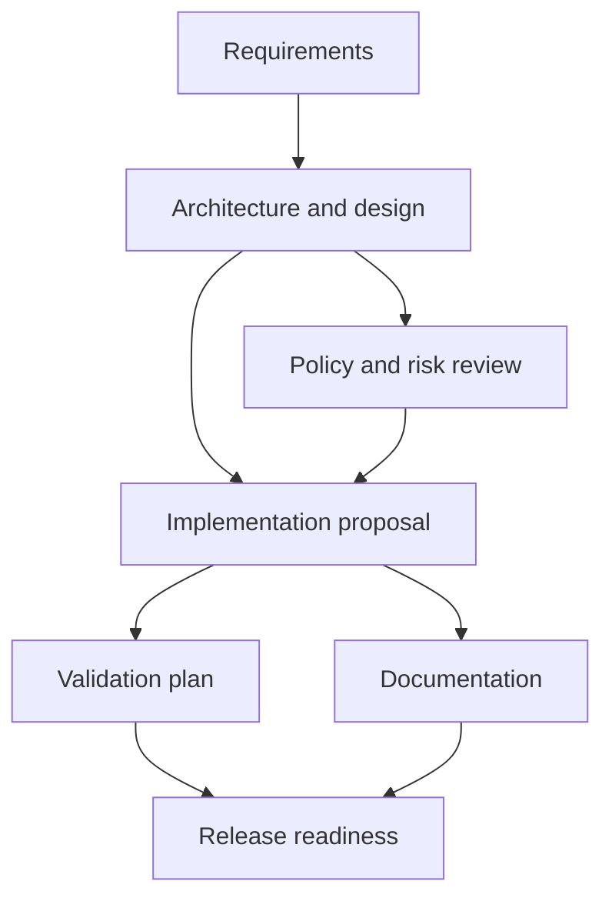

# URL Shortener and Agentic Engineering Workflow

A .NET 10 / ASP.NET Core prototype combining a persistent URL shortener with a governed engineering-workflow orchestrator. The API, orchestration engine, persistence, scenario workers, and tests are C#; SQLite stores links, click aggregates, run snapshots, and audit events.

## Run It

Requirements: .NET 10 SDK.

```bash
dotnet restore UrlShortener.slnx
dotnet test UrlShortener.slnx
ORCHESTRATION_APPROVAL_TOKEN='replace-with-a-long-random-secret' \
	dotnet run --project UrlShortener.Api
```

The API listens at `http://localhost:5055` with the included launch profile and creates `urlshortener.db` in the working directory. Set `ConnectionStrings__Shortener` to change its location. Configure `PublicBaseUrl` (for example, `https://sho.rt`) behind a reverse proxy so returned short links use the configured external origin rather than the request's Host header. Only configure forwarded headers for trusted proxies.

## URL API

Create a link with an optional custom code and UTC expiry:

```http
POST /api/urls
Content-Type: application/json

{"url":"https://example.com/article","customCode":"launch-2026","expiresAt":null}
```

The service accepts absolute HTTP(S) destinations only, rejects embedded credentials, enforces a 2048-character destination limit, and generates cryptographically random eight-character codes. Custom codes allow 3-32 letters, digits, hyphens, or underscores. A unique database index protects against concurrent collisions. Redirects return `302`; missing codes return `404`; expired codes return `410`. `GET /api/urls/{code}/analytics` returns total clicks and up to 30 UTC daily buckets. Click records do not retain IP addresses, full referrers, or user-agent strings.

Additional routes: `GET /health`, `POST /api/urls`, `GET /r/{code}`, and `GET /api/urls/{code}/analytics`. Create requests are rate-limited to 30 per minute per observed remote address.

## Orchestration Model



Each stage has an entry gate, dependencies, and exit gate. The engine executes ready stages as a parallel wave, persists the synchronization point, and advances only when dependencies complete. Implementation and release pause for an authenticated human decision. Decisions include reviewer identity, rationale, timestamp, and requirement revision. Approval, re-plan, and rollback endpoints require `X-Approval-Token` and `X-Reviewer`; the token is compared in constant time. Re-planning increments the revision and invalidates all prior approvals.

Run snapshots preserve current state and cross-stage outputs. Audit events are separately appended to SQLite with per-run sequence numbers, actor, timestamp, stage, revision, and rationale. Execution is bounded to two attempts per stage. Documentation has a deterministic fallback; other exhausted stages safe-stop and restore the most recent approved checkpoint when available. Manual rollback also requires an authenticated reviewer. Metrics report completion success rate, retry and rollback counts and per-run frequencies, safe-stop-to-human-rollback recovery time, and completed-run latency.

The workers are deterministic local C# implementations, not LLM agents: they produce reviewable planning artifacts and do not edit source code, execute arbitrary shell commands, or deploy. The graph, gates, persistence, lineage, policies, and human checkpoints are real and testable; model-backed implementation and test execution are intentionally left behind the `IStageExecutor` boundary. This keeps the prototype runnable without model credentials and makes the autonomy limit explicit.

## Scenario Walkthroughs

All scenarios use `POST /api/orchestration/runs` and return the initial run snapshot, task graph, outputs, gates, and audit history. Poll or inspect it with `GET /api/orchestration/runs/{runId}`.

| Scenario | Decomposition and behavior | Validation and governance |
| --- | --- | --- |
| Greenfield | Normalizes the URL-shortener objective, designs components, reviews risks, then proposes implementation. | Unit/integration/security validation plan and documentation run in parallel; implementation and release require separate approvals. |
| Brownfield | Starts from the existing service and focuses on preserving redirect behavior while adding expiry and privacy-minimized analytics. | Dependencies and release readiness are evaluated as above; tests exercise redirect, analytics, and expiry contracts. |
| Ambiguous | Preserves the vague request, records explicit assumptions and open questions, and marks the run high-impact. | The risk-review artifact flags retention, abuse controls, and expiry semantics. It stops at the implementation approval until a human accepts the assumptions or re-plans with clarified requirements. |

Example request:

```http
POST /api/orchestration/runs
Content-Type: application/json

{"scenario":"ambiguous","requirements":"Make shortened links safer and analytics better."}
```

Approve only after reviewing the returned artifact and gates:

```http
POST /api/orchestration/runs/{runId}/approvals
X-Approval-Token: <configured secret>
X-Reviewer: reviewer@example.com
Content-Type: application/json

{"stageId":"implementation","rationale":"Assumptions reviewed; proceed with stated retention limits."}
```

Use `POST /api/orchestration/runs/{runId}/replan` with a clarified `requirements` value to create a new revision and reset the graph, or provide `changedStageId` and `changedOutput` to invalidate and re-run only that upstream stage's dependent descendants while preserving unrelated completed work. Downstream workers receive completed upstream outputs as context. Previous approvals in the affected graph are invalidated. Use `POST /api/orchestration/runs/{runId}/rollback` to restore the most recent approved checkpoint. `GET /api/orchestration/metrics` returns workflow reliability metrics.

## Validation and Trade-Offs

`dotnet test UrlShortener.slnx` runs HTTP-level integration tests against SQLite, covering URL validation, custom-code conflicts, redirect and click tracking, expiry, all three scenarios, approval authorization, parallel gates, re-planning, bounded retry, safe-stop, rollback, and metrics.

This is a single-process prototype. Per-run locks and rate limiting are in-memory and do not coordinate across replicas; use distributed coordination and a shared production database before horizontal scaling. SQLite is suitable for local evaluation, not high write concurrency. The project uses `EnsureCreated` plus an idempotent audit-table initializer for the prototype; production schema evolution should use reviewed EF Core migrations and backups. Audit rows are append-only through the application path, not cryptographically tamper-proof against database administrators. Reviewer token auth demonstrates the gate but must be replaced by enterprise identity/RBAC, secret rotation, and authorization policy. The public shortener can be abused for phishing; add abuse detection, domain reputation or allowlists, quotas, and operational review before public deployment. Analytics retention and deletion requirements remain a product/compliance decision.

No action automatically changes the repository or deploys. A future model-backed executor should run in a sandbox, produce reviewable diffs, use scoped credentials, record tool inputs/outputs, validate against repository checks, and retain a human release gate.
# URLShortner